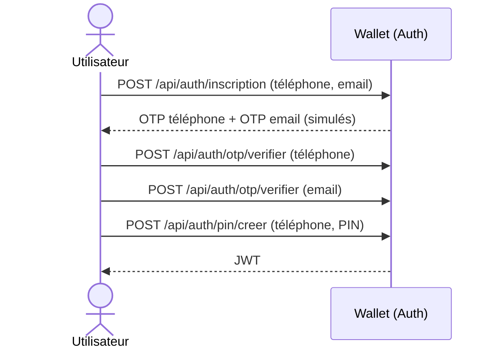

# Wallet Service

Microservice de **portefeuille électronique** : inscription par téléphone et email (OTP simulé), code PIN, authentification JWT, dépôt, retrait et paiement de services.

Il fait partie d'une plateforme de deux microservices indépendants qui communiquent en REST :

| Service | Rôle | Port par défaut | Base de données |
|---|---|---|---|
| **Wallet Service** (ce projet) | Comptes, PIN, JWT, opérations financières | `8081` | `wallet_db` |
| **Prestation Service** | Catalogue, demandes de prestation, ressources, tâches | `8080` | `prestation_db` |

Le Prestation Service appelle le Wallet pour débiter le compte d'un client lors du paiement d'une demande.

## Technologies

- Java 21, Spring Boot 4.1.0, Maven
- Spring Web MVC, Spring Data JPA, Spring Security, Bean Validation
- PostgreSQL
- JWT (jjwt 0.12.6), hachage du PIN avec BCrypt
- Documentation OpenAPI / Swagger UI (springdoc 3.0.3)
- Lombok

## Prérequis

- JDK 21
- Maven (ou le wrapper `./mvnw` fourni)
- PostgreSQL en cours d'exécution

## Installation et lancement

1. Créer la base de données :

   ```sql
   CREATE DATABASE wallet_db;
   ```

   Les tables sont créées automatiquement au démarrage (`ddl-auto: update`).

2. Vérifier `src/main/resources/application.yml` (voir la section Configuration).

3. Lancer l'application :

   ```bash
   ./mvnw spring-boot:run
   ```

4. Ouvrir Swagger UI : <http://localhost:8081/swagger-ui.html>

## Configuration

Toutes les valeurs sensibles se surchargent par variables d'environnement. Les valeurs par défaut ne sont acceptables qu'en développement.

| Variable | Rôle | Défaut (dev) |
|---|---|---|
| `DB_USERNAME` | Utilisateur PostgreSQL | `postgres` |
| `DB_PASSWORD` | Mot de passe PostgreSQL | `postgres` |
| `JWT_SECRET` | Clé de signature des JWT (au moins 32 caractères) | valeur factice à changer |
| `INTERNAL_API_KEY` | Clé partagée avec le Prestation Service pour `/api/payments/**` | valeur factice à changer |

> **Secrets partagés avec le Prestation Service.** `JWT_SECRET` doit être **identique** dans les deux services (le Prestation Service valide les tokens émis ici). `INTERNAL_API_KEY` doit correspondre à `wallet.api-key` du Prestation Service. Si l'une de ces valeurs diffère, les requêtes sont refusées.

## Architecture du projet

```
com.dakartechwallet.walletbackend
├── config        SecurityConfig, OpenApiConfig
├── controller    AuthController, WalletController, PaymentController, UserController
├── dto           Objets de requête et de réponse (les entités ne sont jamais exposées)
├── entity        User, Account, Transaction, OtpCode
├── enums         StatutUser, StatutCompte, TypeTransaction, StatutTransaction, TypeOtp
├── exception     Exceptions métier et GlobalExceptionHandler
├── mapper        Conversions entité vers DTO
├── repository    Repositories Spring Data JPA
├── security      JwtUtil, JwtTokenService, JwtAuthenticationFilter, InternalApiKeyFilter
└── services      AuthService, WalletService, PaymentService, UserService
```

## Utilisation

### 1. Inscription et obtention d'un token

L'OTP est **simulé** : les codes sont retournés dans la réponse de l'API, aucun SMS ni email n'est envoyé.



Exemple :

```bash
# 1. Inscription : retourne codeOtpTelephone et codeOtpEmail
curl -X POST http://localhost:8081/api/auth/inscription \
  -H "Content-Type: application/json" \
  -d '{"telephone":"+221770000001","email":"test@example.com"}'

# 2. Vérification de l'OTP téléphone, puis de l'OTP email
curl -X POST http://localhost:8081/api/auth/otp/verifier \
  -H "Content-Type: application/json" \
  -d '{"destinataire":"+221770000001","type":"TELEPHONE","code":"<codeOtpTelephone>"}'

curl -X POST http://localhost:8081/api/auth/otp/verifier \
  -H "Content-Type: application/json" \
  -d '{"destinataire":"test@example.com","type":"EMAIL","code":"<codeOtpEmail>"}'

# 3. Création du PIN (4 à 6 chiffres) : retourne le JWT
curl -X POST http://localhost:8081/api/auth/pin/creer \
  -H "Content-Type: application/json" \
  -d '{"telephone":"+221770000001","pin":"1234"}'
```

Pour les connexions suivantes : `POST /api/auth/login` avec le téléphone et le PIN.

### 2. Utiliser le token

Ajouter l'en-tête `Authorization: Bearer <token>` aux appels protégés. Dans Swagger UI, cliquer sur **Authorize** et coller le token **sans** le mot « Bearer ».

### 3. Endpoints

| Méthode | Endpoint | Accès | Description |
|---|---|---|---|
| POST | `/api/auth/inscription` | Public | Démarre l'inscription, génère les 2 OTP |
| POST | `/api/auth/otp/demander?destinataire=&type=` | Public | Renvoie un OTP pour une inscription en cours |
| POST | `/api/auth/otp/verifier` | Public | Vérifie un OTP (téléphone ou email) |
| POST | `/api/auth/pin/creer` | Public | Définit le PIN et retourne le JWT |
| POST | `/api/auth/login` | Public | Connexion par téléphone + PIN |
| GET | `/api/users/me` | JWT | Profil de l'utilisateur connecté (contient son `id`) |
| GET | `/api/wallet/solde` | JWT | Consulter le solde |
| GET | `/api/wallet/transactions` | JWT | Historique, du plus récent au plus ancien |
| POST | `/api/wallet/depot` | JWT | Créditer le compte (`{"montant":50000}`) |
| POST | `/api/wallet/retrait` | JWT + PIN | Retirer (`{"montant":10000,"pin":"1234"}`) |
| POST | `/api/payments/initier` | Clé API interne | Débiter pour un service (appelé par le Prestation Service) |

## Règles métier

- **Identité** : un compte est identifié par son numéro de téléphone (unique), l'email est également unique.
- **Inscription** : le PIN ne peut être défini qu'après validation du téléphone **et** de l'email, et une seule fois. Un OTP est valable 5 minutes et n'est utilisable qu'une fois.
- **PIN** : 4 à 6 chiffres, stocké haché en BCrypt, exigé pour le retrait et le paiement. Le dépôt n'en demande pas.
- **Devise** : XOF. Un compte est créé avec un solde de 0.
- **Concurrence** : les débits utilisent un verrou pessimiste sur le compte, en complément d'un verrou optimiste (`@Version`), pour éviter les débits simultanés incohérents.

### Paiement inter-services

`POST /api/payments/initier` reçoit `userId`, `montant`, `serviceId` (l'id de la demande côté Prestation) et `pin`. Le Wallet vérifie dans l'ordre : le compte, le paiement déjà effectué, le PIN, l'état du compte puis le solde.

- **Idempotence** : si un paiement `SUCCES` existe déjà pour ce `serviceId`, il est renvoyé sans redébiter. Un appel répété (réessai réseau, double clic) ne débite donc jamais deux fois.
- **Compensation** : un refus métier (solde insuffisant, compte suspendu) répond **HTTP 200** avec `statut: ECHEC` et une transaction `ECHEC` est tracée. Le client peut réessayer plus tard avec le même `serviceId`.
- **PIN incorrect** : erreur HTTP 401, aucune transaction d'échec n'est créée (c'est une erreur de saisie, pas un refus de paiement).

## Sécurité

| Zone | Mécanisme |
|---|---|
| `/api/auth/**`, Swagger | Public |
| `/api/wallet/**`, `/api/users/**` | JWT (`sub` = téléphone, claim `userId` = identifiant du compte) |
| `/api/payments/**` | En-tête `X-Internal-Api-Key` (appels serveur à serveur) |

## Format des erreurs

```json
{
  "timestamp": "2026-09-28T13:52:45",
  "status": 422,
  "erreur": "Unprocessable Entity",
  "message": "Solde insuffisant",
  "chemin": "/api/wallet/retrait"
}
```

| Code | Cas |
|---|---|
| 400 | Validation, OTP invalide ou expiré, PIN non défini |
| 401 | PIN ou identifiants incorrects, clé API interne invalide |
| 403 | Compte suspendu, ou requête sans JWT sur un endpoint protégé |
| 404 | Utilisateur ou compte introuvable |
| 409 | Compte déjà existant, email déjà utilisé, PIN déjà défini |
| 422 | Solde insuffisant |

Les erreurs de validation contiennent en plus un objet `champs` avec le détail par champ.

## Limites connues

- L'OTP est simulé et retourné dans la réponse : à ne jamais faire en production.
- Aucune limite du nombre de tentatives sur l'OTP (4 chiffres), le PIN ou le login.
- Pas de changement ni de réinitialisation de PIN.
- Pas de remboursement ni d'annulation de paiement.
- Les tokens ne sont pas révocables : ils restent valides 24 h même si le compte est bloqué entre-temps.
- `ddl-auto: update` convient au développement ; en production, utiliser des migrations (Flyway ou Liquibase).